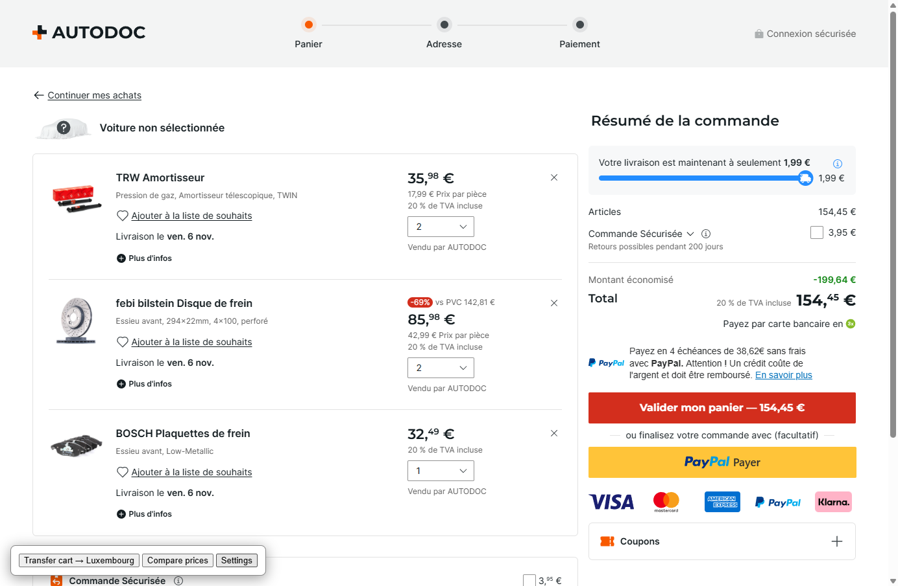
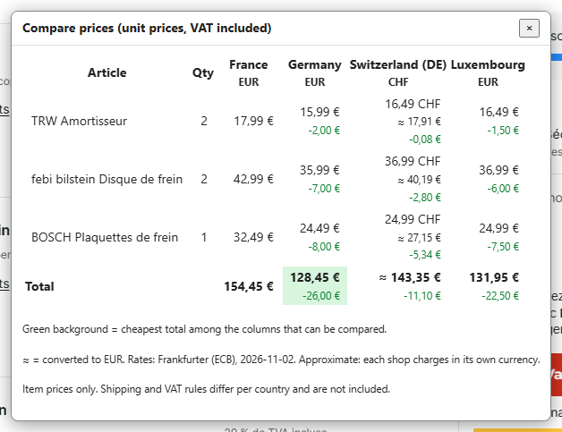
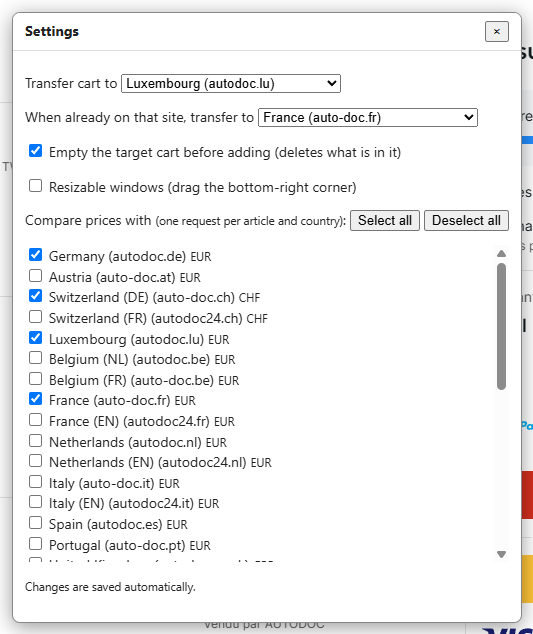

# autodoc-cart

A Tampermonkey userscript for people who shop on one Autodoc country site (e.g. **auto-doc.fr**) and want to check another one (e.g. **autodoc.lu**, often cheaper) without re-adding every article by hand. It works on 34 Autodoc sites (see [Countries](#countries)).

On the cart page (`/basket`) of any supported site it adds three buttons (bottom-left):

- **Transfer cart →** rebuilds the same cart (same articles, same quantities) on another country's site, by default Luxembourg.
- **Compare prices** shows, per article and in total, the price on this site and on the countries you enabled in Settings.
- **Settings** picks the transfer target, the comparison countries and whether the target cart is emptied first.

No build step, no dependencies: one `.user.js` file.

## Install

1. Install [Tampermonkey](https://www.tampermonkey.net/) (Chrome, Edge, Brave, Opera; Firefox is untested, see Limitations).
2. Click [**Install**](https://raw.githubusercontent.com/yinyin99/autodoc-cart/main/autodoc-cart.user.js) (Ctrl+click for a new tab), then click **Install** in the Tampermonkey page that opens:
   [`https://raw.githubusercontent.com/yinyin99/autodoc-cart/main/autodoc-cart.user.js`](https://raw.githubusercontent.com/yinyin99/autodoc-cart/main/autodoc-cart.user.js)
3. Tampermonkey asks to allow cross-site requests to the Autodoc sites listed in the script header. Allow them (needed for the price comparison).

## How to use

1. **Open your cart** on an Autodoc site, e.g. `https://www.auto-doc.fr/basket`. After a few seconds three buttons appear at the bottom-left of the page: **Transfer cart → …**, **Compare prices** and **Settings**. (They only appear on the cart page, and only when it contains articles.)

   
2. **Compare prices.** Click it and wait: a counter ("Fetched 3/8…") shows the script reading the product pages of the other countries, 4 at a time. Then a table shows:
   - one row per article (name, quantity) and one column per country, **this site first**; the other columns also show the difference to this site (green = cheaper, red = more expensive);
   - the **Total** row; the cheapest total has a **green background**;
   - for countries that use another currency (e.g. CHF, GBP, SEK), their own price plus **≈** the same amount converted to this site's currency, so everything can be compared;
   - **n/a** where an article has no price (not sold there, site blocked the request…): hover it to see why. Such an article is left out of the totals of the columns compared with it.

   Click **×** to close the table; closing it while it is still loading stops the comparison (click **Compare prices** again to restart). Prices are per unit, VAT included, shipping not included.

   
3. **Settings.** Everything is saved as soon as you change it:
   - **Transfer cart to**: the country the cart is copied to (default Luxembourg).
   - **When already on that site, transfer to**: where the button sends you when you are on the target site itself (default France), so it also works the other way round.
   - **Empty the target cart before adding** (on by default): the articles already in the target cart are deleted first, so it ends up an exact copy of yours. Turn it off to add on top of what is there.
   - **Compare prices with**: tick the countries to compare. Each costs one request per article, so only France and Luxembourg are ticked by default. **Select all** / **Deselect all** tick or untick every country at once.
   - **Resizable windows**: lets you resize the popups by dragging their bottom-right corner (off by default). You can always move a popup by dragging its title bar.

   
4. **Transfer cart.** Click **Transfer cart → (country)**. A new tab opens on a product page of the target site (your first article): leave it open. It shows its progress ("Adding 2/5…"), then opens the target cart. If some articles could not be added, they are listed instead. Check the quantities and the final total on the cart page before you order. (With an empty cart the three buttons do not appear: there is nothing to transfer.)
5. **Updating.** Tampermonkey checks for new versions by itself. To force it, open the Tampermonkey menu → **Check for userscript updates**.

Popups fit small screens (the table scrolls inside them) and keep their title bar with the × button visible while you scroll.

## Settings

Saved automatically (Tampermonkey storage, shared by all the sites); they apply to every site the script runs on.

| Setting | Default | Meaning |
|---|---|---|
| Transfer cart to | Luxembourg (`www.autodoc.lu`) | Target of **Transfer cart**. |
| When already on that site, transfer to | France (`www.auto-doc.fr`) | Where the transfer goes from the target site itself, so the same button also works the other way round. If it equals the site you are on, the button explains what to change. |
| Empty the target cart before adding | **on** | The target site's cart is emptied (all its articles are removed) before the articles are added, so the target ends up as an exact copy. Turn it **off** to add on top of what is already there. |
| Compare prices with | France + Luxembourg | Every ticked country costs one request per cart article, so only two are on by default. This site is always shown first, whether ticked or not. The **Select all** / **Deselect all** buttons above the list tick or untick every country at once. |
| Resizable windows | off | Lets you resize popups by dragging their bottom-right corner. Applies immediately; turning it off also drops any size you had set. Moving by the title bar always works. |

**Empty the target cart is on by default**: the target cart is the one being rebuilt, but whatever is in it when you press Transfer is deleted, not just overwritten. Only the articles are removed (coupons, "Commande Sécurisée" and addresses are left alone). If emptying fails, the transfer stops and adds nothing; the cart may then be partly emptied.

## Countries

| Country | Site | Currency |
|---|---|---|
| Germany | www.autodoc.de | EUR |
| Austria | www.auto-doc.at | EUR |
| Switzerland (DE) | www.auto-doc.ch | CHF |
| Switzerland (FR) | www.autodoc24.ch | CHF |
| Luxembourg | www.autodoc.lu | EUR |
| Belgium (NL) | www.autodoc.be | EUR |
| Belgium (FR) | www.auto-doc.be | EUR |
| France | www.auto-doc.fr | EUR |
| France (EN) | www.autodoc24.fr | EUR |
| Netherlands | www.autodoc.nl | EUR |
| Netherlands (EN) | www.autodoc24.nl | EUR |
| Italy | www.auto-doc.it | EUR |
| Italy (EN) | www.autodoc24.it | EUR |
| Spain | www.autodoc.es | EUR |
| Portugal | www.auto-doc.pt | EUR |
| United Kingdom | www.autodoc.co.uk | GBP |
| Ireland | www.auto-doc.ie | EUR |
| Denmark | www.autodoc.dk | DKK |
| Norway | www.autodoc.co.no | NOK |
| Sweden | www.autodoc.se | SEK |
| Finland | www.autodoc.fi | EUR |
| Poland | www.autodoc.pl | PLN |
| Czech Republic | www.autodoc.cz | CZK |
| Slovakia | www.autodoc.sk | EUR |
| Slovenia | www.autodoc.si | EUR |
| Hungary | www.autodoc.hu | HUF |
| Romania | www.autodoc24.ro | RON |
| Bulgaria | www.autodoc.bg | EUR |
| Greece | www.autodoc.gr | EUR |
| Estonia | www.autodoc.ee | EUR |
| Latvia | www.autodoc.lv | EUR |
| Lithuania | www.autodoc.lt | EUR |
| International (EN) | www.autodoc.parts | EUR |
| Brazil | www.autopecas.br.com | BRL |

The list (`SITES` at the top of the script: country, host, currency) is the only thing to edit to add or drop a site. The `@match` and `@connect` header lines must list the same hosts, plus `api.frankfurter.dev` for the exchange rates (Tampermonkey requires it); `node test.js` checks that.

**Currencies.** Each column keeps showing the site's own price. For columns in another currency than this site's, the price is also converted to this site's currency (shown as "≈ …") so totals, differences and the green "cheapest" highlight work across all countries. Rates come from [Frankfurter](https://frankfurter.dev) (ECB reference rates, one call for all currencies), fetched at most **once a day** and cached for 24 hours in Tampermonkey storage; the popup states the rate date. They are approximate: each shop charges in its own currency, and card or bank fees are not included. The rates are only requested when a comparison involves more than one currency. If they cannot be fetched, the cached ones are used even if older (the popup says so); with no cache at all nothing is converted: only columns in the same currency are compared (all euro sites together, the two Swiss sites together, ...) and a column in another currency than this site's shows its own total with no difference to this site. A country where an article has no price is left out of the totals of every column compared with it, so the columns stay comparable (hover "n/a" for the reason).

## Updates

The header has `@version`, `@updateURL` and `@downloadURL` pointing at this repo. Tampermonkey checks them periodically and updates when `@version` is higher; to force it, use **Check for userscript updates** in the Tampermonkey menu.

## How it works (and why)

- All sites use the same product URLs (`/brand/<article id>`) and the same article ids, so the "other site" URL is the same path on the other domain.
- Adding to the cart is `POST /ajax/cart/update` (`id`, `quantity`, CSRF header). The server rejects it unless the page has passed a Cloudflare Turnstile check, so the script does **not** call it from a userscript request. It runs the call inside the target site's product page using the page's own `fetch`, which attaches the Turnstile token. That is why the transfer lands on a product page and not directly on the cart (the cart page does not load that code).
- Emptying the cart uses the same page `fetch`: `GET /ajax/cart/mini-basket` lists the cart, then `POST /ajax/cart/update` with `quantity=0&set=true` removes each article (the call behind the legacy cart's delete button). The cart is read again afterwards and the transfer only goes on if it is empty. (The new React cart page uses a Next.js server action instead, whose id changes with every site release, so it is not used.)
- The queued cart is passed between the two domains with `GM_setValue` (local to your browser) and is deleted as soon as it is consumed, because the add request is additive: running it twice would double the quantities.
- All selectors and URLs are in one block at the top of the script, so a site redesign should be a small fix.

## Limitations

- With **Empty the target cart** off, quantities are **added** to whatever is already in the target cart.
- Transfer and emptying the cart were verified live only on **fr, lu and de**. The other sites are assumed to run the same platform (same product URLs, same cart requests) but are untested; the price comparison works wherever the product page shows a price.
- Articles are added one after the other (parallel cart updates race on the server and drop articles); only price reads run in parallel.
- Only the articles and quantities are copied. Vehicle selection, "Commande Sécurisée" and other services, coupons, and addresses are not.
- An article that does not exist on the other site is reported as not added; it is not substituted. With emptying on, the old target cart is already gone by then.
- **Prices are shown VAT included and per country** (e.g. France 20 %, Luxembourg 17 % at the time of writing). Shipping is **not** compared (it depends on destination, weight and cart total). Check the final total on the cart page before ordering.
- Price comparison uses the product page of each other site. If Cloudflare answers the userscript request with a challenge (HTTP 403 shown on hover over "n/a"), open that site once in the same browser, then retry.
- Needs a browser with CSS `:has()` (Chrome/Edge 105+). Written for Tampermonkey on Chromium, where `unsafeWindow` shares the page's JavaScript context; Firefox and other managers are untested.
- The sites change their markup without notice; if buttons stop appearing, check the selectors at the top of the script.

## Development

```
node test.js
```

Runs assert-based checks of the pure functions (price parser, host swap, settings, transfer target, exchange-rate parsing, comparison across several countries and currencies with and without rates, request pool) and of the userscript header: `@match`/`@connect` match `SITES` (plus the rates host), `@version` is semver, `@downloadURL`/`@updateURL` point at `main`, and the `@grant` list equals what the code uses. The userscript exports the helpers only when loaded by Node (`typeof module !== 'undefined'`); in the browser it runs normally.

CI (`.github/workflows/test.yml`) runs `node --check autodoc-cart.user.js` and `node test.js` on every push and pull request.

## Disclaimer

This project is **not affiliated with, endorsed by, or connected to Autodoc** (AUTODOC SE or any of its sites). It is provided as is, without warranty. You are responsible for checking your order, prices and your use of the sites' terms.

## Privacy

The script stores in Tampermonkey storage on your machine: your settings, the cached exchange rates, and, while a transfer is pending, a short-lived copy of your cart (article ids, quantities, displayed prices, product paths). It sends no data anywhere except to the Autodoc sites listed in the script (the product pages it reads for the countries you ticked, and the cart requests the sites' own code would make) and, at most once a day and only when a comparison involves a non-euro currency, to the [Frankfurter](https://frankfurter.dev) exchange-rate API (`api.frankfurter.dev`). That request carries no cart data, only the list of currencies; like any web request it reveals your IP address to that server. No analytics, no other third-party servers.

## License

MIT, see [LICENSE](LICENSE).
