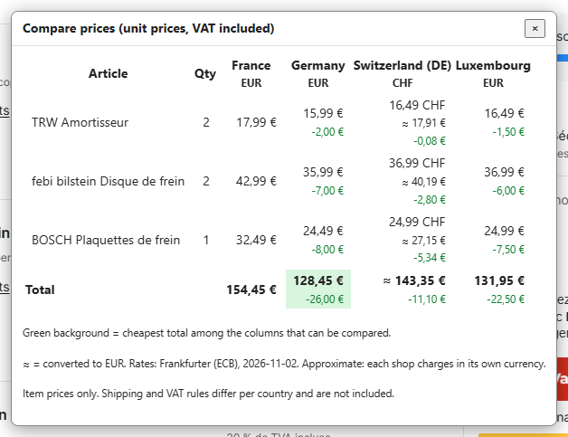

# How it works

## Comparing prices

- All Autodoc sites use the same product URLs (`/brand/<article id>`) and the same article ids. The "other site" URL is just the same path on another domain.
- To compare, the script reads the product page of each article on each ticked country. It does this 4 pages at a time, and the popup shows a counter ("Fetched 3/8…").
- Prices are per unit, VAT included, shipping not included.
- The price comparison works wherever the product page shows a price.

## Transferring the cart

- Adding to the cart is a `POST /ajax/cart/update` request (article id, quantity, CSRF header).
- The server refuses it unless the page has passed a Cloudflare Turnstile check. So the script does not send it from the userscript itself. It runs the request inside the target site's product page, using the page's own `fetch`, which carries the Turnstile token.
- That is why the transfer opens a product page and not the cart directly: the cart page does not load that code.
- Emptying the cart uses the same page `fetch`. `GET /ajax/cart/mini-basket` lists the cart, then `POST /ajax/cart/update` with `quantity=0&set=true` removes each article. The cart is read again afterwards, and the transfer only goes on if it is empty. The newer React cart page uses a Next.js server action whose id changes with every site release, so it is not used.
- The queued cart is passed between the two domains with `GM_setValue`, which stays local to your browser. It is deleted as soon as it is used, because adding is additive: running it twice would double the quantities.
- Articles are added one after the other. Parallel cart updates race on the server and drop articles. Only price reads run in parallel.
- All selectors and URLs sit in one block at the top of the script, so a site redesign should be a small fix.

## Exchange rates

Rates are fetched from `api.frankfurter.dev` at most once a day and cached for 24 hours in Tampermonkey storage. See [Countries](countries.md#currencies) for how they are used.

## Limitations

- Only articles and quantities are copied. Vehicle selection, "Commande Sécurisée" and other services, coupons and addresses are not.
- An article that does not exist on the other site is reported as not added. It is not replaced by another one. With emptying on, the old target cart is already gone by then.
- Prices are shown VAT included and per country (for example France 20 %, Luxembourg 17 % at the time of writing). Shipping is not compared, because it depends on destination, weight and cart total. Check the final total on the cart page before ordering.
- Transfer and emptying the cart were verified live only on fr, lu and de. The other sites are assumed to run the same platform but are untested.
- The script needs a browser with CSS `:has()` (Chrome or Edge 105+). It is written for Tampermonkey on Chromium, where `unsafeWindow` shares the page's JavaScript context. Firefox and other script managers are untested.
- The sites change their markup without notice.

## Troubleshooting

**"n/a" in the table, with HTTP 403 when you hover it.** Cloudflare answered the request with a check. Open that site once in the same browser, then click **Compare prices** again.

**The buttons do not show.**
- Make sure you are on the cart page (`/basket`) and that the cart contains articles.
- Make sure the script is enabled in the Tampermonkey menu.
- Recent Chrome and Edge versions may require turning on developer mode on the extensions page, or **Allow User Scripts** in the Tampermonkey extension details. Then reload the page.
- The site may have changed its layout. Check the selectors at the top of the script.

**Chrome page translation (Google Translate) is on.** The script's own buttons and popups are marked `translate="no"`, so they stay in English and keep working. Only the shop's own text, such as article names, is translated.

**Some articles were not added.** They are listed after the transfer. They are probably not sold on the target site.

**Updates.** The script header has `@version`, `@updateURL` and `@downloadURL` pointing at this repository. Tampermonkey checks them regularly and updates when `@version` is higher. To force it, open the Tampermonkey menu and choose **Check for userscript updates**.
