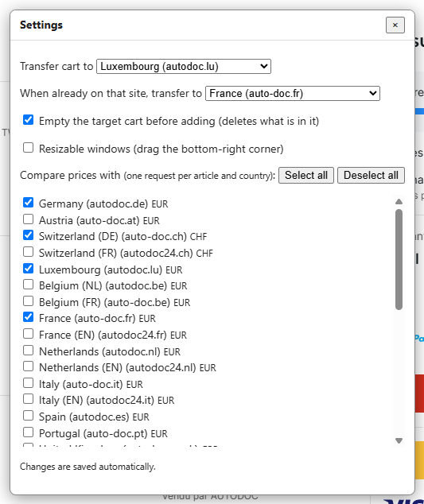

# Settings

Click **Settings** at the bottom-left of your cart page. Everything is saved as soon as you change it, and it applies to every Autodoc site the script runs on.

| Setting | Default | What it does |
|---|---|---|
| Transfer cart to | Luxembourg (`www.autodoc.lu`) | The country your cart is copied to. |
| When already on that site, transfer to | France (`www.auto-doc.fr`) | Where the button sends you when you are already on the target site, so it also works the other way round. If this is the same as the site you are on, the button tells you what to change. |
| Empty the target cart before adding | On | Removes the articles already in the target cart, so it becomes an exact copy of yours. Turn it off to add on top of what is there. |
| Compare prices with | France and Luxembourg | The countries shown in the comparison. Each one costs one request per article, so only two are on by default. Your current site is always shown first. **Select all** and **Deselect all** tick or untick every country. |
| Resizable windows | Off | Lets you resize the popups by dragging their bottom-right corner. Turning it off also drops any size you set. You can always move a popup by its title bar. |

## Emptying the target cart

This is on by default. Whatever is in the target cart when you press **Transfer** is deleted, not just overwritten.

- Only articles are removed. Coupons, "Commande Sécurisée" and addresses are left alone.
- If emptying fails, the transfer stops and adds nothing. The cart may then be partly emptied.
- With the option off, quantities are added to what is already in the target cart.
